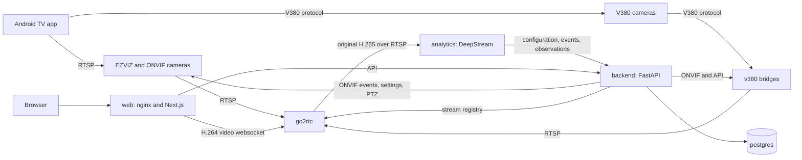

# Home Camera Manager

A self-hosted manager for the IP cameras of a home. It shows every camera live in the browser, drives PTZ cameras and their settings over ONVIF, records what the cameras report, and runs its own video analytics on an NVIDIA GPU with DeepStream: people, vehicles and animals in zones and across lines, faces, tampering, counts, objects left behind, falls, number plates and a person's way across the cameras. An Android TV app shows the cameras on the TV straight from the cameras. Everything runs on one computer in the home network; no picture, face or event leaves it.

## Features

### Watching

- Wall: every enabled camera in one grid that fills the screen, on the cameras' sub streams, with automatic or fixed 1, 2x2 and 3x3 layouts and fullscreen for the wall and for each tile. A camera with several lenses in one picture takes one tile per lens.
- Camera page: one camera on its main or sub stream with optional sound, its details and status, and a PTZ pad with speed; the arrow keys and plus or minus drive it while the view has focus. A multi-lens camera shows its lenses side by side or one at a time.
- Live overlay: a toggle draws the boxes the analytics is tracking over the live video.

### Camera control

The camera page's sidebar reads and writes what the camera itself offers over ONVIF, and labels a section the camera does not offer: PTZ presets and the home position, the light and siren of V380 cameras, video encoders, image settings, motion detection, the SD card's recording timeline, the clock with time sync, and reboot. SD card playback is off by default; see Limitations.

### Events and alerts

- Camera events: the backend keeps an ONVIF PullPoint subscription per camera and turns motion, tamper, storage failure and reboot messages into events with a snapshot.
- Analytics events: intrusion into a zone, line crossing in or out, loitering, crowding, vehicles, animals, tamper, objects left and taken, falls and faces, each with a snapshot, the boxes of its objects and a clip from 5 s before it starts to 5 s after it ends, at most 60 s.
- Alerts: a global arm mode in the top bar (Disarmed, Home, Away, Schedule) and an alert policy per zone and line decide which events alert. Alerts raise a toast on every page unless muted in the top bar, and count on the Events tab.
- Events page: live list with filters for camera, kind, label and day, counts for the filtered events, and a side panel with the snapshot, boxes, clip, plate candidates, the person's journey and Find this person.

### Analytics

- One shared detector, RF-DETR Medium, and the NvDCF tracker on every enabled view at 8 frames per second by default; each lens of a multi-lens camera is its own view.
- Zones and lines drawn on a fresh picture of the view, with class filters, minimum dwell, loitering, crowd counts, schedules and alert policies. Zones on a moving lens keep the picture they were drawn on and are suspended while the lens points elsewhere.
- Tamper watch on every view: covered, blurred, too dark and moved, with one learned reference for day and one for infrared night.
- Counts: crossings in and out per line by hour and day, and the occupancy of areas bounded by lines, on the Counts page.
- Objects left and taken in a zone, with an optional background comparison for objects the detector has no class for.
- Animals: dogs, cats and birds make animal events that do not alert unless a zone or line includes them.
- Falls (beta) on the views where they are turned on, from body keypoints.
- Number plates (beta) read on vehicle events in daylight and searchable by plate.
- Journeys (beta): a person's tracks on different cameras linked by appearance, such as Yard, then Entrance, then Corridor, and Find this person across cameras on the Events and Search pages.
- Auto-follow on a moving PTZ lens, off on every view by default.

analytics/README.md describes the pipeline, the rules and every feature in detail.

### Faces, people and search

- Face recognition on the views where it is on: known people are named, other faces gather into unknown clusters such as Unknown 3, seen 5 times, which Who is this? turns into a person and relabels their past events.
- People page: known people with their sample faces and latest sightings, enrollment from photos that must each show exactly one face, merging and deleting; deleting a person wipes their faces and crops.
- Search page: every event filtered by time, cameras, views, kinds, labels, zones, lines, person or cluster and alerts, as a list or a grid; Find similar on any face or on an uploaded photo; Find this person on any person event.
- The wall shows a recognised person's name on the tile that saw them for 8 s.

### Network

- Discover scans the home subnet for cameras and opens the add form prefilled for any it finds.
- Coverage plans Wi-Fi coverage on a floor plan with routers, walls by material and devices, shows a heatmap per band and suggests router placement.
- Health probes every router and camera every 10 s and shows uptime, latency, outages and the device that caused each outage.

### TV

tv/ holds an Android TV app that connects straight to the cameras on the home Wi-Fi and needs nothing from this computer: a grid of every camera, fullscreen with sound and PTZ from the remote. tv/README.md describes it.

## Supported cameras

| Camera | How it connects | Events | PTZ |
|---|---|---|---|
| EZVIZ | RTSP and ONVIF with Local Service Settings on in the EZVIZ app; user admin and the camera's image encryption password | motion, storage, reboot | none on the tested models |
| Other ONVIF cameras | stream paths read from ONVIF GetStreamUri | the ONVIF topics they offer | from the ONVIF profile |
| Plain RTSP cameras | an RTSP path given by hand | none | none |
| V380 | a bridge container per camera speaks the V380 protocol on port 8800 and serves RTSP and ONVIF, because V380 RTSP stops answering once a device password is set and some models have none | ONVIF on the camera itself where it has ONVIF | through the bridge or the camera's own ONVIF |

The brand fills the defaults of fields left empty:

| Brand | ONVIF port | Main path | Sub path | PTZ |
|---|---|---|---|---|
| ezviz | 80 | /Streaming/Channels/101 | /Streaming/Channels/102 | no |
| v380 | 8899 | /live/ch00_0 | /live/ch00_1 | yes |
| onvif | given | from ONVIF GetStreamUri | from ONVIF GetStreamUri | from the profile |
| rtsp | none | required | optional | no |

A V380 bridge needs the camera's address and device ID in V380_PTZ_n_HOST and V380_PTZ_n_ID, and the shared V380_USERNAME and V380_PASSWORD set as the device login in the V380 Pro app. Register the camera with brand onvif, host home-cameras-v380-ptz-n, device address the camera's own address, RTSP port 8554, ONVIF port 8080, main path /live, no sub path, no login and PTZ on. Another V380 camera gets another bridge service and variable group in the same shape. A dual-lens camera sends both pictures stacked in one frame; set Lenses to 2 and every view, the wall and the analytics treat each band as its own lens.

## Architecture



| Service | Image | Role |
|---|---|---|
| postgres | postgres:17.6-alpine | Users, cameras, analytics configuration, events, people, faces, appearances, counts, floor plans and health samples |
| go2rtc | alexxit/go2rtc:1.9.14-hardware | Pulls each camera's stream, serves the original to the analytics over RTSP and an H.264 transcode encoded on NVENC to the browser |
| backend | home-cameras-backend:local | FastAPI: sign in, cameras, discovery, ONVIF control and events, analytics configuration, events, people, search, counts, floor plans, health and the go2rtc stream registry |
| analytics | home-cameras-analytics:local | DeepStream 9.1: detection, tracking, rules, faces, appearance, pose, plates, tamper watch, the rolling recording buffer and event clips |
| v380-ptz-1, v380-ptz-2 | home-cameras-v380-bridge:local | One bridge per V380 camera: V380 protocol in, RTSP on 8554 and ONVIF with PTZ, light and siren on 8080 out |
| web | home-cameras-web:local | nginx serving the Next.js static export and proxying the API and the video websocket |

The analytics service reads its configuration from the backend every 5 s, so zone and rule changes apply without a restart, and posts events and observations back on internal routes that nginx never serves. Only web and go2rtc's RTSP port publish ports: web on loopback and on HC_LAN_BIND, RTSP on HC_LAN_BIND only, so phones on the home Wi-Fi reach the app while a VPN on the same computer does not.

## Requirements

- Linux with Docker Engine, Docker Compose v2 and the NVIDIA Container Toolkit.
- An NVIDIA GPU with NVDEC and NVENC and a driver that supports CUDA 13.2, which is 595.58 or newer; the analytics image is DeepStream 9.1 on CUDA 13.2 and TensorRT 10.16. The stack is built and measured on a GeForce RTX 5070 with 12 GB.
- GPU memory: about 2.1 GB for the analytics with every feature on, and 0.2 to 0.3 GB for each H.264 transcode go2rtc runs while a browser watches.
- RAM: the analytics container is capped at 6 GB and uses about 1.5 GB with four cameras; the other services together use under 1 GB.
- CPU: go2rtc decodes the browser transcodes on the CPU, under half a core for four 5 MP cameras on the wall; the analytics uses about a quarter of a core.
- Disk: about 30 GB for the images, most of it the DeepStream base image, 2.5 GB for the models, 0.5 GB for the TensorRT engines, and the events volume, which grows by a few GB a day of clips with several people about and is pruned by HC_EVENTS_RETENTION_DAYS.

A Jetson Orin Nano profile exists but has not run on a Jetson; see Jetson Orin Nano below.

## Quick start

1. Copy the configuration and fill in the secrets:

   ```
   cp .env.example .env
   ```

   Set HC_SECRET_KEY to a long random value, HC_TV_RTSP_PASSWORD and HC_ANALYTICS_TOKEN to two other random values, HC_ADMIN_PASSWORD, HC_TIMEZONE to the zone schedules use, and HC_LAN_BIND to this computer's home network address, reserved in the router so it does not change.

2. Download the models. Each script checks every file against a pinned checksum and prints its licence; read the licences before use.

   ```
   scripts/download-models.sh
   scripts/download-face-models.sh
   scripts/download-secondary-models.sh
   ```

   The first fetches RF-DETR and exports it to ONNX, the second the InsightFace face models, which are published for non-commercial research only, and the third the appearance, pose and plate models. The scripts read HC_ANALYTICS_MODELS_DIR and HC_ANALYTICS_FACE_MODELS_DIR from the shell, not from .env, and default to analytics/models and analytics/models/face, the folders compose mounts by default.

3. Start the stack:

   ```
   docker compose up -d --build
   ```

   The first start of the analytics builds its TensorRT engines into the analytics-engines volume, which takes a few minutes; later starts reuse them.

4. Open http://127.0.0.1:8750 and sign in with HC_ADMIN_USERNAME and HC_ADMIN_PASSWORD. The backend creates that user on first start and never overwrites its password afterwards.

5. Add cameras on the Cameras page or find them with Discover, then turn on analytics per view on each camera's page and draw zones and lines there.

## Configuration reference

Every variable lives in .env, which mirrors .env.example group by group.

| Name | Default | Meaning |
|---|---|---|
| HC_LAN_BIND | none | Home network address the web app and go2rtc's RTSP port are published on |
| HC_WEB_PORT | 8750 | Port of the web app |
| HC_DB_HOST | postgres | Postgres host |
| HC_DB_PORT | 5432 | Postgres port |
| HC_DB_NAME | home_cameras | Postgres database |
| HC_DB_USER | home_cameras | Postgres user |
| HC_DB_PASSWORD | home_cameras | Postgres password |
| HC_SECRET_KEY | none | Signs sessions and encrypts camera passwords; changing it makes stored camera passwords unreadable |
| HC_ADMIN_USERNAME | admin | User created on first start |
| HC_ADMIN_PASSWORD | none | Password of that user on first start |
| HC_SESSION_HOURS | 168 | Lifetime of a session |
| HC_GO2RTC_URL | http://go2rtc:1984 | go2rtc API address |
| HC_TRANSCODE_HARDWARE | empty | go2rtc hardware option added to every transcode, such as cuda for GPU decoding; empty decodes on the CPU |
| HC_TV_RTSP_USERNAME | tv | RTSP user go2rtc asks every client outside its container for |
| HC_TV_RTSP_PASSWORD | none | RTSP password of go2rtc |
| HC_DISCOVERY_SUBNET | 192.168.1.0/24 | Subnet Discover scans |
| HC_MONITOR_INTERVAL_SECONDS | 20 | Interval of the camera status monitor and the go2rtc reconciliation |
| HC_HEALTH_INTERVAL_SECONDS | 10 | Interval of the health probes |
| HC_HEALTH_RETENTION_DAYS | 14 | Days health samples are kept |
| HC_EVENTS_RETENTION_DAYS | 30 | Days events are kept with their snapshots, clips and face samples, and person appearances and journeys with them, so Find this person never offers a sighting whose event is gone |
| HC_COUNTS_RETENTION_DAYS | 400 | Days line counts are kept; a count is one small row per line, minute, direction and label, a few hundred a day, so a year of them costs little and a day can be compared with the same day a year before |
| HC_REPLAY_ENABLED | false | Offers SD card playback, one session per camera |
| HC_TIMEZONE | UTC | Time zone of schedules, counts and area resets |
| HC_ANALYTICS_URL | http://analytics:8080 | Status endpoint of the analytics service |
| HC_ANALYTICS_TOKEN | none | Shared token of the backend's internal analytics routes and the analytics status endpoint |
| HC_ANALYTICS_MODELS_DIR | ./analytics/models | Host folder of the analytics models, mounted read-only |
| HC_ANALYTICS_FACE_MODELS_DIR | ./analytics/models/face | Host folder of the face models, mounted read-only |
| HC_ANALYTICS_DETECTOR | rfdetr-medium | Shared detector |
| HC_ANALYTICS_APPEARANCE | true | Appearance vectors and journeys on views that allow them |
| HC_ANALYTICS_POSE | true | Pose and falls on views with falls on |
| HC_ANALYTICS_PLATES | true | Plate reading on views with plates on |
| HC_ANALYTICS_PLATE_FINDER | text | text for the PaddleOCR text detector, lpdnet for NVIDIA LPDNet |
| HC_ANALYTICS_FPS | 8 | Analysis rate of views that set none |
| HC_ANALYTICS_CLIP_ENCODER | auto | auto, h264_nvenc, libx264 or copy |
| HC_ANALYTICS_CLIP_BEFORE | 5 | Seconds a clip starts before its event |
| HC_ANALYTICS_CLIP_AFTER | 5 | Seconds a clip runs after its event ends |
| HC_ANALYTICS_CLIP_MAX | 60 | Longest clip in seconds |
| HC_ANALYTICS_BUFFER_SECONDS | 120 | Seconds of each camera's stream kept in memory for clips |
| CAMERA_PASSWORD | none | Password of the EZVIZ cameras for the OpenCV viewer in cv/ |
| CV_CAMERA_HOSTS | 192.168.1.104,192.168.1.106 | Addresses the OpenCV viewer opens |
| V380_USERNAME | admin | Device login of the V380 cameras |
| V380_PASSWORD | none | Device password of the V380 cameras |
| HC_DEVICE_ONVIF_PORT | 8899 | ONVIF port of bridged V380 cameras on their own address |
| V380_PTZ_1_HOST | none | Address of the first V380 camera |
| V380_PTZ_1_ID | none | Device ID of the first V380 camera |
| V380_PTZ_2_HOST | none | Address of the second V380 camera |
| V380_PTZ_2_ID | none | Device ID of the second V380 camera |

The face recognition thresholds and the analytics service's own settings are in analytics/README.md.

## Privacy

- Everything runs on this computer. Video, snapshots, clips, faces, appearance vectors and plate reads are stored in its postgres and events volumes and never sent anywhere; no cloud service is used.
- Faces never leave the machine: enrollment photos go from the browser to the backend and on to the local analytics service, which answers with the face's position, quality and embedding.
- Event data, face samples seen by the cameras, appearances and journeys are deleted after HC_EVENTS_RETENTION_DAYS. Enrolled photos stay until their person is deleted, which wipes the person's embeddings and crops.
- The web app publishes only on loopback and the home network address, and every page, API call and video connection needs a session.

## Model licences

| Model | Use | Licence | Fetched by |
|---|---|---|---|
| RF-DETR Medium | shared detector | Apache 2.0 | download-models.sh |
| RF-DETR Nano, Small and Large | detector candidates and the Jetson profile | Apache 2.0 | download-models.sh --all |
| NVIDIA PeopleNet and TrafficCamNet | detector candidates for comparison | NVIDIA Open Model License | download-models.sh --all |
| InsightFace antelopev2: SCRFD 10G and glintr100 | face detection and recognition | non-commercial research use only | download-face-models.sh |
| OSNet-AIN x1.0 MSMT17 | person appearance for journeys | MIT | download-secondary-models.sh |
| RTMPose-m body7 | body keypoints for falls | Apache 2.0 | download-secondary-models.sh |
| PaddleOCR PP-OCRv4 text detector and English recogniser, ONNX by RapidOCR | number plates | Apache 2.0 | download-secondary-models.sh |
| NVIDIA LPDNet | optional plate finder | NVIDIA AI Enterprise EULA, not an open licence | download-secondary-models.sh --all |

The weights are never committed. The DeepStream base image is under the NVIDIA Deep Learning Container License, and the V380 bridge builds PyanSofyan/V380Decoder, which has no licence file. The repository itself has no licence yet.

## Limitations

- Camera events carry no labels: EZVIZ and V380 cameras send only motion over ONVIF, and their person and vehicle detection stays in the vendors' clouds, so labels come from the local analytics. A V380 camera without ONVIF sends no events at all.
- SD card playback: the EZVIZ cameras reset a local playback session right after PLAY, and opening several sessions at once made a camera restart, so playback stays off and allows one session per camera when turned on.
- Number plates are read by day only: infrared light makes plates glare white at night, and grey pictures are refused. Plates leaning in the picture are levelled before reading; the region code is rarely read, and distant cars are too small.
- Journeys and Find this person match within the same light only: daylight colour and infrared night pictures of the same person do not match.
- V380 cameras burn their own detection rectangle into the picture when humanoid detection is on in the V380 Pro app, and it shows in face crops; switching that option off removes it.
- Falls and objects left and taken are verified on synthetic input and against a live baseline without real occurrences.
- Some V380 PTZ cameras ignore GotoPreset and turn a fixed step per move command, so auto-follow returns by retracing its moves; the bridged V380 streams carry no sound.

## Security

- Every page, API call and video connection needs a session; nginx checks it before it proxies the video websocket and snapshots, and answers 404 for every other go2rtc path and for /internal.
- Camera passwords are stored encrypted with a key derived from HC_SECRET_KEY and are never returned by the API.
- go2rtc asks RTSP clients for HC_TV_RTSP_USERNAME and HC_TV_RTSP_PASSWORD except on loopback, so its own ffmpeg transcodes need no credentials.
- The analytics service publishes no port; its status endpoint and the backend's internal analytics routes need HC_ANALYTICS_TOKEN as a bearer token.
- The bridges serve RTSP and ONVIF without authentication and sound the siren through an unauthenticated API, so they stay on the internal network and never publish ports.

## How it works

### Streaming

The backend registers two go2rtc streams per enabled camera, main and sub, each with the camera's RTSP URL followed by an ffmpeg H.264 video transcode without audio, and reconciles go2rtc with the registry on every monitor tick. The browser player asks for H.264 only, so H.265 cameras play through the transcode; with sound on, the camera page also asks for audio, which go2rtc takes from the camera's own source. go2rtc.yaml holds no camera streams and is mounted read-only, so camera credentials stay out of files; its h264 template encodes with h264_nvenc and decodes on the CPU.

### Events

One ONVIF PullPoint subscription per enabled camera reads its event topics, long-polls PullMessages, renews before the subscription expires and reconnects with backoff; a camera that refuses PullMessages is polled by subscribing every 5 s. A bridged camera is subscribed on its own address and HC_DEVICE_ONVIF_PORT. Start and stop messages within 5 s merge into one event, an open event closes after 10 minutes, and states a camera reports when a subscription starts never open an event, because their start is unknown. Event times use this computer's clock and keep the camera's own time beside it. GET /api/v1/events lists events with filters and paging, and /api/v1/events/stream pushes changes as server-sent events.

### Health

Every enabled network device and camera is probed with a TCP connect every HC_HEALTH_INTERVAL_SECONDS. A bridged camera is probed on its own address and port 8800, never on the bridge, because the bridge answers even when the camera is gone. Two failed samples open an outage and the first answer closes it; when the device a target connects through is down at the same time, the outage names the top device of that chain as its cause.

### Composed TV streams

The backend also serves the PC side of an earlier TV path: TV clients pair with a code through /api/v1/tv, and go2rtc's exec streams tv_wall and tv_tile_0 to tv_tile_15 in go2rtc.yaml run go2rtc-tv.sh, which composes the cameras with ffmpeg on h264_nvenc. The Android TV app in tv/ does not use this path.

## Jetson Orin Nano

compose.jetson.yml runs the stack on a Jetson Orin Nano with DeepStream 9.1 or newer on JetPack 7.2, which has no hardware video encoder:

```
docker compose -f compose.yml -f compose.jetson.yml up -d --build
```

The analytics service uses RF-DETR Nano at 4 frames per second, encodes clips with libx264, keeps one minute of buffer, reads no number plates and is capped at 3 GB; go2rtc runs from the plain image with a libx264 transcode template and no GPU reservation. Export the detectors on a PC with scripts/download-models.sh --all and copy the model folder over. Verified on a PC: the merged configuration, that the DeepStream 9.1 image has an arm64 variant with CUDA 13.2, and the libx264 clip path. Not verified: the stack has never run on a Jetson, so the arm64 build of the analytics image and its parser library, RF-DETR Nano's speed there and the CPU cost of go2rtc's browser transcodes are open, and the composed TV streams still need h264_nvenc.

## Development

The host needs no Node or Python; every tool runs in a container as your own user. AGENTS.md lists the exact commands and the rules the code follows.

- Backend: FastAPI in backend/app, with one folder per module under app/modules holding its models, schemas, services, routers and dependencies; Alembic migrations in backend/migrations are generated by autogenerate only. Tests run with uv, ruff and pytest.
- Analytics: the service in analytics/app, the custom RF-DETR box parser in analytics/parsers and the tests in analytics/tests, run with the test stage of analytics/Dockerfile.
- Frontend: Next.js static export in frontend, checked with pnpm lint, typecheck and build.
- TV app: Kotlin in tv/app with unit tests run by Gradle.
- OpenCV viewer: cv/ holds a separate desktop viewer for the EZVIZ streams, described in cv/README.md.
