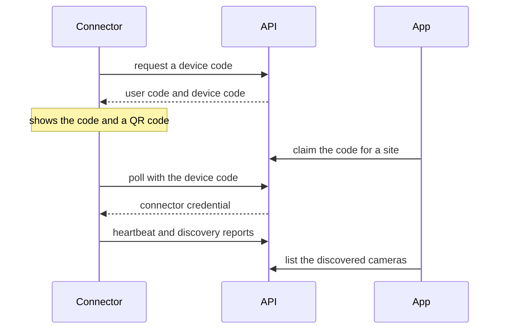

A connector pairs with RFC 8628, the device authorization grant: a device without a keyboard shows a code, and a person who is signed in elsewhere claims it. The API's side of the protocol is implemented; the connector container itself is [planned](../getting-started/connector.mdx).

- The connector sends its name, version and WireGuard public key with its request. The code lives SSS_CONNECTOR_CODE_MINUTES, 15 by default, is used once, and binds the connector to one site.
- The connector polls every SSS_CONNECTOR_POLL_SECONDS, 5 by default, until an admin or owner claims the code; then it receives its own credential, which it sends as a bearer token on every later call.
- Heartbeats report the connector's version, address, health and camera reachability, and a connector without one for SSS_CONNECTOR_OFFLINE_SECONDS counts as offline.
- Central calls the connector's agent at the address the connector reports in direct mode, or at its overlay address in tunnel mode.

## Routes the connector calls

<include>../../../../generated/api-tags/connector-device.md</include>

## Routes the apps call

<include>../../../../generated/api-tags/connectors.md</include>

The [API reference](./api/index.mdx) has the request and response schemas of every route.
